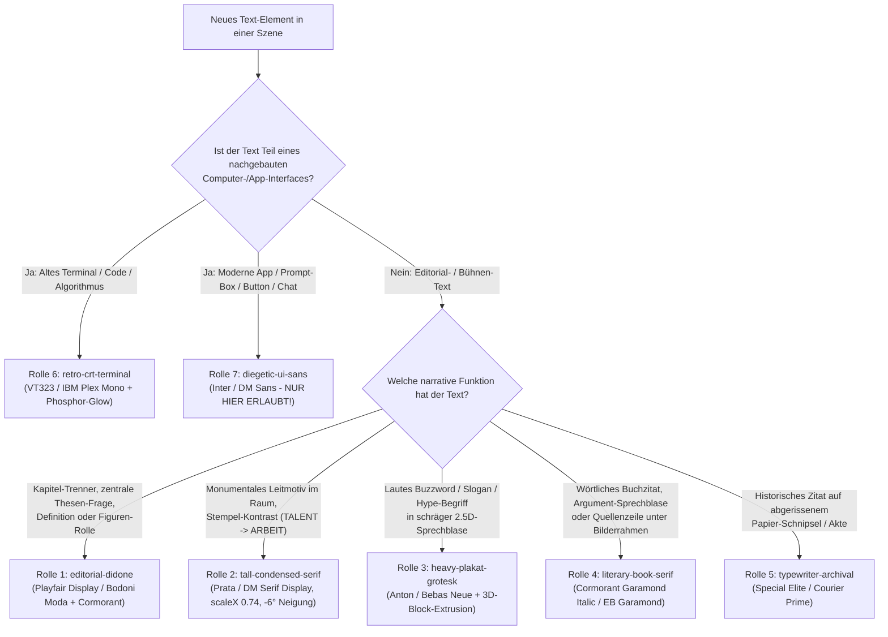

# Editorial Typography – Szenen- & Rollen-basierte Schriftart-Auswahl

> **Oberstes Gesetz (Empirisch aus dem Ultralativ-Referenzvideo `kUuwvJfQfIk` abgeleitet):**
> Verwende **NIEMALS** eine generische Sans-Serif (`Inter`, `Arial`, `Roboto`) für Kapitel-Titel, Thesen-Fragen, Zitate oder dramatische Schlagworte!
> Der charakteristische Editorial-Essay-Look entsteht dadurch, dass **klassische, kontrastreiche Serifenschriften (Didone / Antiqua)** und **schmale, hohe Condensed-Display-Schriften** die Hauptbühne beherrschen, während **Sans-Serif ausschließlich für nachgebaute App-Interfaces (Buttons, Suchfelder, Chats)** reserviert bleibt.

---

## 1. Die 7 verbindlichen Schrift-Rollen (Font-Archetypen)

Jedes einzelne Text-Element einer Szene muss im Storyboard **exakt einer** dieser 7 Rollen zugewiesen werden:

| Rolle | Wann zwingend einsetzen? | Referenz-Beweis (`kUuwvJfQfIk`) | Google-Font / CSS-Stack | Schnitt, Farbe & Effekt-Regeln |
|---|---|---|---|---|
| **1. `editorial-didone`** *(Haupt-Serife des Kanals)* | - Zentrale Thesen-Fragen - Kapitel-Trenner (`KAPITEL I: ...`) - Philosophische Kernaussagen (`UMSETZUNGS-AUTOMAT`) - Rollen-Labels über Spielfiguren (`Schöpfer`, `Auftraggeber`) | `frame_0028.jpg` (`02:16`) `frame_0029.jpg` (`02:20`) `frame_0102.jpg` (`08:24`) `frame_0123.jpg` (`10:12`) | **`Playfair Display`** oder **`Bodoni Moda`** *(Sublines: `Cormorant Garamond`)* | - **Kapitel-Karte**: Zeile 1 Uppercase Bold (`700–900`, Tracking `0.06em`), Zeile 2 Ultra-Light/Light (`300`, hoher Strichkontrast). - **Thesen-Frage**: Regular (`400`) in Schwarz/Cremeweiß, Schlüsselwörter in Bold (`700`) + Signalfarbe (`#0f5499` Blau / `#c83e2b` Rot). |
| **2. `tall-condensed-serif`** *(Monumentale Display-Antiqua)* | - Große Kapitel-Leitmotive im Raum (`MÜHELOSE EXZELLENZ`, `ÖKONOMIE`, `ENTTÄUSCHUNG.`) - Gestempelte Gegenpole (`TALENT` $\rightarrow$ `ARBEIT`) - Leitmotiv-Sätze (`Na ja, für euch reicht's.`) | `frame_0021.jpg` (`01:40`) `frame_0061.jpg` (`05:00`) `frame_0206.jpg` (`17:08`) `frame_0221.jpg` (`18:20`) | **`Prata`**, **`DM Serif Display`** oder **`Playfair Display`** mit `transform: scaleX(0.74)` / **`Instrument Serif`** | - Versalien (`UPPERCASE`), enges Tracking (`-0.02em`), vertikal gestreckt. - Oft um **`-6deg` bis `-8deg` geneigt** (`rotate(-6deg) skewX(-4deg)`). - **Farbe**: Cremeweiß (`#f5efe1`) oder Gold-Creme-Verlauf (`#fceabb` $\rightarrow$ `#f8f6f0`) mit scharfem 3D-Block-Schatten (`4px 6px 0 #111`) + weichem Raum-Schatten. |
| **3. `heavy-plakat-grotesk`** *(Laute Buzzword-Block-Schrift)* | - Gesellschaftliche Hype-Begriffe & Slogans in Sprechblasen (`PARADIGMENWECHSEL`, `MUSTER / DENKWEISEN`) - Plakative Werbe-Versprechen (`KI – DIE ZUKUNFT`) | `frame_0035.jpg` (`02:50`) `sheet_002.jpg` (`01:24`) `sheet_003.jpg` (`03:04`) | **`Anton`**, **`Bebas Neue`** oder **`Oswald`** (`weight: 700–900`) | - Immer `UPPERCASE`, extrem kompakt (`line-height: 0.92`). - Um `-6deg` geneigt, kräftige Akzentfüllung (z. B. Kaminrot `#a51c1c` oder Gelb `#f5d10d`) mit **harter schwarzer 3D-Extrusion** (`6px 6px 0px #000`). - **Wichtig**: Die Dachzeile darüber (*„ChatGPT, Midjourney & Co.:“*) steht immer im Kontrast dazu in **Kursiv-Serife (`editorial-didone italic`)**! |
| **4. `literary-book-serif`** *(Literarische Zitat- & Dialog-Antiqua)* | - Lange wörtliche Buch-/Fachzitate neben einer Quelle - Argumentations-Sätze in weißen/beigen Sprechblasen (`Ich bin aber nicht talentiert.`) - Kleine Museums-Quellenzeile unter Bilderrahmen (`Caspar David Friedrich, ca. 1818`) | `frame_0055.jpg` (`04:30`) `frame_0150.jpg` (`12:24`) `frame_0206.jpg` (`17:08`) | **`Cormorant Garamond`** oder **`EB Garamond`** / **`Lora`** | - **Lange Zitate frei auf Tapete**: `Italic` (`400i`), Zeilenhöhe `1.38`, Cremeweiß mit feinem dunklem Schlagschatten (`0 2px 6px rgba(0,0,0,0.65)`), Seitenangabe (`Seite 49`) rechtsbündig aufrecht (`400`). - **In Sprechblasen**: Aufrecht (`400`/`500`) in Tiefschwarz `#111` auf warmem Papier-Beige `#f3ead8` (`border: 3px solid #000`). - **Bildunterschrift**: `14–18px`, `#d0d0d0`, direkt zentriert unter dem Rahmen. |
| **5. `typewriter-archival`** *(Mechanische Schreibmaschine)* | - Historische Zitate, Zeitungs-Schnipsel, alte Prognosen oder Akten-Notizen auf abgerissenem Papier (`Das Auto ist eine vorübergehende Erscheinung...`) | `frame_0090.jpg` (`07:24`) | **`Special Elite`** oder **`Courier Prime`** / **`Cutive Mono`** | - Immer auf physischem Papier-Träger (abgerissene Kanten, leichtes Papierkorn) in gedämpftem Tinten-Schwarz (`#1a1a18`), Zeilenabstand `1.45`. |
| **6. `retro-crt-terminal`** *(80er/90er Pixel- & Terminal-Monospace)* | - Code, Algorithmen, frühe Informatik (`ELIZA 1966`), ASCII-Banner und technische Flussdiagramme auf einem CRT-Monitor | `frame_0172.jpg` (`14:15`) | **`VT323`**, **`IBM Plex Mono`** oder **`Share Tech Mono`** | - Leuchtendes Phosphor-Weiß/Grün (`#f0f6f0`) auf tiefschwarzem CRT-Glas (`#050605`) mit Phosphor-Bloom (`text-shadow: 0 0 8px rgba(240,255,240,0.6)`). |
| **7. `diegetic-ui-sans`** *(Neutrale System-Grotesk)* | - **NUR** für nachgebaute moderne Software-UIs (Prompt-Suchleisten, `Generate`-Buttons, Fiverr-Chat-Bubbles) und trockene 1-Satz-Roboter-Sprechblasen (`Kein Plan, lol.`) | `sheet_007.jpg` (`06:28`) `sheet_009.jpg` (`09:00`) `sheet_014.jpg` (`13:52`) | **`Inter`** oder **`DM Sans`** | - Sauber, schmucklos (`400` für Eingabetext, `600` für Buttons). - **STRENG VERBOTEN** für Überschriften, Thesen, Kapitel oder Zitate! |
| **8. `historical-fraktur`** *(Historische Dokumente & Erlasse)* | - Kaiserliche/Historische Erlasse, Urkunden, Gesetzestexte des 19. Jh. und dramatische historische Zäsuren | Archiv-Referenz | **`UnifrakturMaguntia`** (lokal im Repo) | - Historische Fraktur mit Ligaturen, warmes Papierweiß/Elfenbein mit Tiefschatten (`0 2px 6px rgba(0,0,0,0.85)`). |

> **Permanente Font-Vorlagen im Repo (`editorial/remotion/shared/fonts/` & `editorial/public/fonts/`):**
> Alle 16 Schriftfamilien (28 TTF-Dateien) liegen vollständig lokal im Repository vor (`catalog.json` und `fonts.css`). Kein FOUC, kein Nachladen, 100 % offline-fähig für Remotion, Manim, HyperFrames und GSAP.

---

## 2. Entscheidungsbaum für die KI (Welche Schrift in welcher Situation?)

Wenn der KI-Regie-Skill eine Szene für das Storyboard plant, durchläuft er für **jeden Text im Bild** diesen Entscheidungsbaum:

---

## 3. Pflicht-Regeln für Typografie-Inszenierung & Animation

1. **Das Gesetz der Schrift-Paarung (Serif + Condensed Contrast)**:
   - Wenn ein großes Schlagwort in `heavy-plakat-grotesk` (Rolle 3) oder `tall-condensed-serif` (Rolle 2) steht, muss die einleitende Dachzeile oder Unterzeile (z. B. *„ChatGPT, Midjourney & Co.:“* über *„PARADIGMENWECHSEL“*, oder *„Generative KI ist ein“* über *„UMSETZUNGS-AUTOMAT“*) immer in einer **feineren Antiqua / Kursiv-Antiqua (`editorial-didone`)** gesetzt werden.
2. **Farb-Akzentuierung einzelner Schlüsselwörter**:
   - In Thesen-Sätzen (`frame_0028.jpg`) oder Leitmotiv-Sätzen (`frame_0021.jpg`) wird genau **ein** bedeutungsunterscheidendes Wort pro Zeile farblich hervorgehoben (z. B. `Kunst` in Preußischblau `#0f5499`, `Bedroht` / `euch` in Zinnoberrot `#c83e2b` oder Warm-Orange `#e06324`), während der Rest des Satzes in Cremeweiß (`#f4f1ea`) oder Tiefschwarz (`#111111`) bleibt.
3. **Keine flachen „Schwebetexte“ ohne Verankerung**:
   - Text auf gemusterten Tapeten bekommt **niemals** eine weiße Comic-Kontur (wie bei Punktgenau), sondern entweder:
     - einen **gerichteten dunklen Schlagschatten** (`filter: drop-shadow(0 4px 10px rgba(0,0,0,0.65))`) bei freistehenden Serif-Zitaten,
     - eine **echte 3D-Block-Extrusion** (`text-shadow`-Stapel oder Three.js `ExtrudeGeometry`) bei Monumental-Begriffen,
     - oder einen **physischen Träger** (Papier-Schnipsel mit Risskante, Sprechblase mit `3px` schwarzem Rahmen und `#f3ead8` Füllung).
4. **Wort-synchrone Typo-Animation**:
   - Lange Zitate (`literary-book-serif`) blenden nicht als ganzer Textblock ein, sondern bauen sich **Wort für Wort oder Satzteil für Satzteil** synchron zur Sprecherstimme (`TL.wordStart`) mit einem sanften Opacity/Y-Reveal auf.
   - Monumentale Begriffe (`tall-condensed-serif` / `heavy-plakat-grotesk`) rasten Buchstabe für Buchstabe oder als wuchtiger Stempel-Impuls auf das betonte Wort ein.
5. **Dokumentations-Pflicht im Storyboard**:
   - Im Storyboard muss jede Szene unter dem Punkt **Typografie & Schrift-Rolle** explizit angeben, welche Rolle (`1` bis `7`) und welche konkrete Schriftfamilie für jedes sichtbare Textelement verwendet wird.
